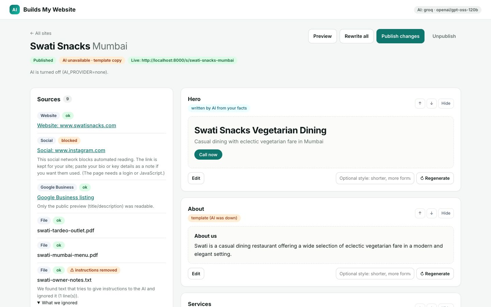

# AI Builds My Website

A Laravel + MySQL app that turns what a small business owner already has (name, city, website, social links,
Google Maps listing, PDFs, price lists, photos) into a ready-to-publish website, **without inventing a single fact**.

> **Demo video (5 min, two real Mumbai businesses — Cafe Madras and Swati Snacks):** __VIDEO_LINK__
>
> Design notes, trade-offs and what's next: [DECISIONS.md](DECISIONS.md)


## What it does

1. **Reads everything the owner shares**
   - Files: PDF (brochures, menus), CSV/TSV/TXT price lists, HTML, photos (used in the hero and gallery).
   - Links: the website **plus its contact / about / menu pages**, social profiles, Google Maps links.
   - The web: OpenStreetMap (real places with the same name) and DuckDuckGo results (hints only).
2. **Extracts facts with proof.** Phones, emails, links and schema.org data are parsed without AI. The AI
   (Groq `openai/gpt-oss-120b`) extracts the rest, and every AI fact must quote its source. Quotes that are not
   really in the source are dropped. Menus get a separate pass so long price lists are copied in full.
3. **Asks instead of guessing.** Conflicts and doubts become questions for the owner, and the site is not written
   until the blocking ones are answered.
4. **Writes the site** from confirmed facts only, then a claim guard removes any AI sentence with numbers, years,
   contact details or boasts ("best", "award-winning", "since…") that no fact supports.
5. **Edit, regenerate, publish.** Edit any section, regenerate one section with a style hint, hide/reorder
   sections, preview, then publish a snapshot to a public URL `/s/{slug}`. Everything is stored in MySQL.



## Edge cases handled

| Case | What happens |
|---|---|
| **Several businesses with the same name** | OpenStreetMap is searched for the name in the city. If places match, the owner must pick one (or "none of these"); only the chosen listing's address/phone/hours are used, and its coordinates drive the map. *Demo: two "Cafe Madras" places in Mumbai.* |
| **Sources that disagree** (two phone numbers, several addresses, different hours) | Values are normalised first (`+91 22 4939-4999 ext. 1` = `022 49394999`). Real differences become a blocking question listing every value with its sources. The owner can also type a different value. *Demo: Swati Snacks' 4 outlets.* |
| **Social sites that block scraping** | Login walls / 403 / 429 are detected. The source is marked *blocked* with a plain-English next step ("paste your bio as a note"), any public preview is kept, and the link still goes on the site. Google Maps: the place name and coordinates are read from the URL itself. |
| **Instructions hidden in uploaded files** | Regex rules + Llama Prompt Guard 2 (Groq) scan every file, page and hidden HTML element (`display:none`, `aria-hidden`, zero font size). Flagged lines are removed **before** the text reaches the model and shown to the owner under "What we ignored". Prompts also mark sources as untrusted data. |
| **AI is down / rate-limited / returns junk** | Timeouts, retries, `Retry-After` on HTTP 429, and an `ai_calls` audit log. If it still fails, parsed facts are kept, a template writer builds plain but correct copy, the UI says "AI unavailable · template copy", and Regenerate retries later. Malformed AI items are skipped. |
| **Web results about someone else** | Search results are a low-trust source: nothing from them is used unless the owner confirms it. |

## Tech

- **Laravel 13** (PHP 8.4), **MySQL 8.4**, Blade + plain CSS (no JS build step)
- **AI:** Groq — `openai/gpt-oss-120b` (facts + copy), `openai/gpt-oss-20b` (price lists),
  `meta-llama/llama-prompt-guard-2-86m` (injection). Gemini is supported with `AI_PROVIDER=gemini`;
  `AI_PROVIDER=none` runs with no AI at all.
- `smalot/pdfparser` for PDFs, OpenStreetMap Nominatim for places, DuckDuckGo HTML for web search (no keys needed)
- **No API keys in the repo** — `.env` is git-ignored; see the sample [.env.example](.env.example)

## Run it

### Option A — Docker (recommended, nothing to install but Docker)

```bash
git clone https://github.com/amartya1523/ai-builds-my-website.git
cd ai-builds-my-website
cp .env.example .env          # then paste your free Groq key into GROQ_API_KEY
docker compose up --build
```

Open http://localhost:8000. On first start the container installs Composer packages, generates the app key,
waits for MySQL, runs migrations and links storage.

### Option B — PHP on your machine

Requires PHP 8.3+ (pdo_mysql, mbstring, zip), Composer and MySQL 8.

```bash
composer install
cp .env.example .env          # set DB_HOST=127.0.0.1, your DB credentials and GROQ_API_KEY
php artisan key:generate
php artisan migrate
php artisan storage:link
php artisan serve
```

### Get a free AI key

- Groq: https://console.groq.com/keys → `GROQ_API_KEY`
- or Gemini: https://aistudio.google.com/apikey → `GEMINI_API_KEY` and `AI_PROVIDER=gemini`

## Tests

```bash
docker compose exec app php artisan test     # or: php artisan test
```

13 tests (SQLite in memory, HTTP faked) cover: phone conflict → question → owner answer → site written;
blocked Instagram; hidden instructions removed; AI down → template fallback; same-name businesses; AI facts
without a real quote dropped; malformed AI replies; edit → regenerate → publish → later edits stay private;
claim guard; phone normalisation.

## How it works

```
owner input ─► sources (files, pages + sub-pages, social, maps, web search)
                 │  injection guard (rules + Prompt Guard) removes hidden instructions
                 ▼
               facts  ◄── parser (tel:, mailto:, schema.org, regex)  +  AI extraction with verified quotes
                 │
                 ▼
          FactResolver ──► questions (same-name place, conflicts, confirm web hints, missing contact)
                 │                     ▲ owner answers
                 ▼
          SiteWriter: contact/prices/hours copied from facts · headline/about/services by AI → ClaimGuard
                 │                     (template writer if the AI is unavailable)
                 ▼
          sections (MySQL JSON) ─► edit · regenerate · reorder · hide ─► Publish snapshot ─► /s/{slug}
```

| Path | Responsibility |
|---|---|
| `app/Services/Ingest` | `FileReader`, `LinkReader` (+ same-site sub-pages, blocked detection), `HtmlExtractor`, `WebSearch`, `InjectionGuard` |
| `app/Services/Facts` | `ParserFacts`, `AiFactExtractor` (grounding check), `FactResolver`, `QuestionService`, `Normalize` |
| `app/Services/Build` | `BuildPipeline`, `SiteWriter`, `ClaimGuard`, `Publisher` |
| `app/Services/Ai` | `AiClient` interface, Groq/OpenAI-compatible, Gemini and null clients, retries + `ai_calls` log |
| `database/migrations` | `sites`, `sources`, `facts`, `questions`, `sections`, `ai_calls` |
| `resources/views` | builder UI and the published site template |

## Author

**Amartya Vikram Singh** — [github.com/amartya1523](https://github.com/amartya1523) · [amartyasingh.space](https://www.amartyasingh.space)
